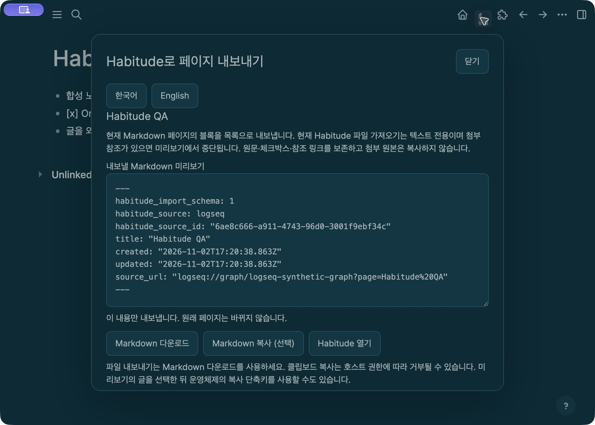

# Habitude for Logseq · 0.1.0

한국어: 현재 열린 Markdown 페이지를 Habitude 가져오기 파일로 내보냅니다. 명령 팔레트에서 **Habitude: 페이지 내보내기** 또는 도구 모음의 **리본 h 아이콘**을 누릅니다. 내보낼 내용을 확인하고 **Markdown 다운로드** 또는 **Markdown 복사**를 선택하세요. Habitude의 **설정 → 데이터 → 파일 가져오기 → Logseq**에서 저장한 `.md` 파일을 미리 본 뒤 가져옵니다. **Habitude 열기**는 본문 없이 Habitude 웹사이트를 엽니다. 플러그인 화면에서 한국어·English를 선택할 수 있습니다.

English: Open a Markdown page and run **Habitude: Export current page** in the command palette, or click the **ribbon h icon** in the toolbar. Review the exact export, then choose **Download Markdown** or **Copy Markdown**. In Habitude, select **Settings → Data → File import → Logseq**, preview the `.md` file and confirm. **Open Habitude** opens the website without note content. The plugin UI supports Korean and English.

## Install / 설치

Unzip `habitude-logseq-0.1.0.zip` into a folder. In Logseq desktop enable developer mode, open Plugins → Load unpacked plugin, and choose the folder containing `package.json`. This release is manually installable; marketplace catalog review is separate from a public download release. No mobile support is claimed.

ZIP을 폴더에 풀고 Logseq 데스크톱에서 개발자 모드 → 플러그인 → 압축 해제 플러그인 불러오기로 `package.json`이 있는 폴더를 고릅니다. 등록 심사를 통과했다고 표시하지 않습니다.

## Supported content and privacy

- Markdown **file graphs** only. DB graphs, Org pages, whiteboards, incomplete blocks or oversized trees stop instead of producing a partial export.
- Logseq desktop **0.10.15** is supported with a positively identified local file graph. When this host omits the optional page format, every block must explicitly identify Markdown. Unknown and empty-format trees are rejected. Later hosts must also report `checkCurrentIsDbGraph() === false`; other versions have not been tested in the actual app.
- Reads only the open page and its block tree after an explicit command. It reads twice and refuses an export if the selected source changes.
- The review uses Logseq's supported keyed native `provideUI` presentation. Close removes only this plugin's review and clears its snapshot. It does not show or hide a full-screen plugin iframe, access the parent document, navigate the source page, or require `effect: true`.
- The outline is serialized as Markdown bullets. Each block's text, checkbox text and source links are retained; this is an SDK page snapshot, not a byte-identical copy of the underlying `.md` file.
- Stable page UUID plus real native timestamps, when provided, support repeat imports and renamed export files. An unavailable source creation date stays absent.
- Original pages are not edited. Attachments remain source links and are not copied or backed up. No automatic habit-completion mapping.
- Habitude's file importer currently accepts text only. Local/resource attachment references stop import preview rather than producing a note with missing photographs.
- No API account, analytics or automated network request. The official SDK is bundled locally; the plugin does not load a CDN. A local Blob download and clipboard copy happen only when selected.
- Limits: 1 MiB, 2,000 blocks, nesting depth 40 and 30,000 lines. Finish active block editing before export.

다운로드를 요청한 뒤 실제 파일이 저장되었는지는 Logseq의 다운로드 폴더/선택한 폴더에서 확인하세요. 자동·양방향 동기화 기능은 아닙니다.

## Verification and upstream code

Synthetic host API tests cover selection changes, legacy schema compatibility, missing or indeterminate DB APIs, unsupported graph rejection, escaped title/body rendering, Close and reopen, clipboard denial, explicit download and source preservation. Actual-host checks use an isolated Logseq **0.10.15** profile with synthetic Korean/English writing and a disposable Habitude Vault. Results and exact package hashes are recorded with the release; these checks do not establish mobile, DB-graph or all-version compatibility. If the host denies clipboard access, the UI directs you to Download Markdown.

On the tested **0.10.15** host, an activated foreground window with coordinate/mouse interaction passed two consecutive open → interaction → Close cycles while keeping the source page visible. Download Markdown opened the native macOS Save dialog and saved the file; import into a fresh disposable Habitude Vault inserted one entry, and reimport left it unchanged. Source file bytes stayed unchanged. These are bounded checks of this host and file-graph workflow, not a promise of compatibility with every version.

The hidden plugin iframe's optional clipboard write was denied on this host. Download Markdown is the primary verified export path; select the preview text and use the OS Copy shortcut as another option. The plugin does not request extra clipboard privileges. Earlier AXPress/background screenshot tests showed a blank main area while accessibility retained the source page; Tab repainted it. That discrepancy was not reproduced in the foreground mouse test and remains an automation/capture limitation. Perfect AX automation behavior is not claimed.

Uses the official [Logseq SDK](https://logseq.github.io/plugins/) `@logseq/libs` **0.3.4**, upstream commit `3de7c75154b628dadfdb53dae6253c8bf5e2ab1b` (the registry's `next` channel at build time; the older `latest` channel is 0.0.17). Distribution includes the unmodified runtime, notices, source/provenance and upstream license. This Logseq package is offered under **AGPL-3.0-only**; that scope does not change the separate Habitude app's license. See `THIRD_PARTY.md` and `LICENSE` inside the release.

Official API references: [Editor](https://logseq.github.io/plugins/interfaces/IEditorProxy.html), [App](https://logseq.github.io/plugins/interfaces/IAppProxy.html), [page metadata](https://logseq.github.io/plugins/interfaces/PageEntity.html), [marketplace submission](https://github.com/logseq/marketplace#how-to-submit-your-plugin).

## Build this source repository

The runnable plugin is at the repository root. Authored source, deterministic archive builder, tests, verified SDK tarball and preferred SDK source are under `source/`. Run `npm test`, then `npm run build` and `npm run verify`. The builder may fetch the pinned official SDK/source/license on its first run into a temporary cache; plugin runtime uses local files only. Generated artifacts are under `source/dist/`.

## Actual desktop review

[English screenshot](screenshots/actual-host-en.png) · [Verification and limitations](HOST_VERIFICATION.md)
